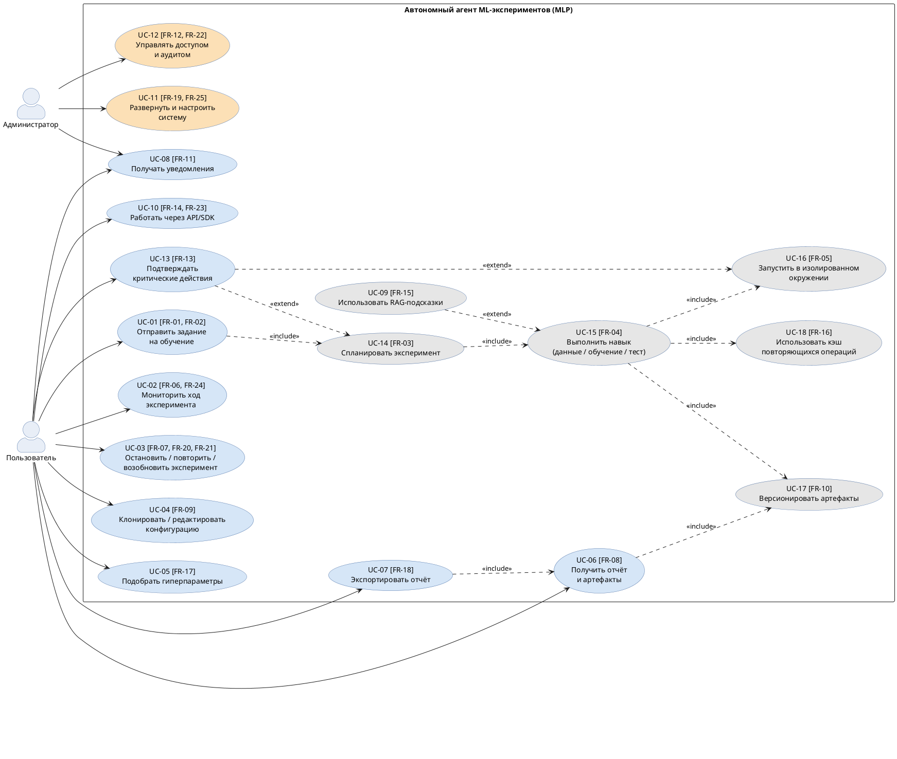

# Лабораторная работа №1. Формулирование требований к программной системе

| Поле | Значение |
|---|---|
| **Студент** | Бердников Андрей Константинович |
| **Группа** | РИС-23-3 |
| **Вариант** | Разработка автономного агента с навыками обучения и тестирования нейронных сетей (MLP) |
| **Постановка задачи** | [README.md](../../README.md) — требования к системе и варианту |
| **Репозиторий** | https://github.com/AndreyBerdnikov322/Software-system-architecture-design |
| **Дата сдачи** | 02.12.2026 |

**Тема:** Анализ предметной области и формулирование требований к программной системе.

**Цель работы:** Научиться анализировать поставленную задачу, выделять заинтересованных лиц, формулировать функциональные и нефункциональные требования, представлять результаты в виде диаграммы вариантов использования.

---

## Краткое описание системы

Разрабатывается автономный программный агент, который автоматизирует полный цикл ML-экспериментов с многослойными перцептронами (MLP): приём задания от сотрудника, планирование эксперимента, подготовка окружения, запуск обучения в изолированном контейнере, мониторинг ресурсов, тестирование модели на отложенной выборке и формирование отчёта. Агент предназначен для ML-инженеров, исследователей и аналитиков Пермского центра поддержки принятия решений и решает проблему рутинных операций, низкой воспроизводимости и нестандартизированных ML-процессов. Система не имеет собственного UI — интеграция выполняется потребителями через API и SDK, а локальное развёртывание и настройку выполняет администратор. В архитектуру включена векторная БД для RAG-компонента (поиск по документации, логам прошлых экспериментов и лучшим практикам) и кэш для ускорения повторяющихся операций.

---

## Оглавление

1. [Стейкхолдеры](#1-перечень-заинтересованных-лиц-стейкхолдеров)
2. [Функциональные требования](#2-перечень-функциональных-требований)
3. [Диаграмма вариантов использования](#3-диаграмма-вариантов-использования)
4. [Нефункциональные требования](#4-перечень-нефункциональных-требований)
5. [Предположения](#5-перечень-сделанных-предположений-повышенная-сложность)
6. [Чек-лист самопроверки](#6-чек-лист-самопроверки)

---

## 1. Перечень заинтересованных лиц (стейкхолдеров)

Выделено 8 стейкхолдеров, из них 2 внешних (SH-07 — потребители API, SH-08 — поставщики GPU-инфраструктуры). Для каждого указано не более двух конкретных целей, а влияние обосновано: кто принимает решения, кто пользуется системой ежедневно. Для диаграммы вариантов использования стейкхолдеры сгруппированы в двух акторов в соответствии с ролевой моделью (предположение A-02).

| ID | Стейкхолдер | Роль | Интересы / цели | Влияние | Обоснование влияния |
|----|-------------|------|-----------------|---------|---------------------|
| SH-01 | ML-инженер | Основной пользователь | Быстрый запуск экспериментов; воспроизводимость результатов | высокое | Ежедневный пользователь, формирует основной поток заданий; его обратная связь определяет приоритеты доработок |
| SH-02 | Исследователь | Пользователь | Гибкая конфигурация экспериментов; клонирование и сравнение моделей | высокое | Ежедневный пользователь, задаёт требования к конфигурациям, подбору гиперпараметров и сравнению моделей |
| SH-03 | Аналитик | Пользователь | Понятные отчёты с метриками и артефактами; экспорт результатов | среднее | Потребляет результаты, но не управляет запуском; влияет на состав и форматы отчётов |
| SH-04 | DevOps/администратор | Владелец инфраструктуры | Изоляция окружений и лимиты ресурсов; стабильная работа кластера | высокое | Отвечает за развёртывание и эксплуатацию; без выполнения его требований к изоляции и квотам система не будет принята в эксплуатацию |
| SH-05 | Руководитель центра | Заказчик | Сократить время экспериментов; контролировать расходы на дорогие GPU-операции | высокое | Принимает решения о бюджете и приёмке проекта, утверждает дорогие операции |
| SH-06 | Служба безопасности | Контролёр | Разграничение доступа; аудит критических действий | среднее | Не пользуется системой ежедневно, но её требования безопасности обязательны и проверяются при аудите |
| SH-07 | Потребители API (внешние команды) | Интеграторы (внешний) | Стабильный документированный API/SDK; независимость от UI | среднее | Не принимают решений о системе, но ломающие изменения API останавливают их собственные сервисы |
| SH-08 | Поставщики GPU-инфраструктуры (внешние) | Партнёры (внешний) | Использование ресурсов в рамках выделенных квот | низкое | Влияют только через квоты и условия предоставления ресурсов; решений по системе не принимают |

### 1.1. Соответствие стейкхолдеров акторам

На диаграмме вариантов использования используются только два актора: **Пользователь** и **Администратор**. Стейкхолдеры либо входят в одну из этих ролей, либо не взаимодействуют с системой напрямую.

| Актор | Стейкхолдеры | Назначение актора |
|-------|--------------|-------------------|
| **Пользователь** | SH-01, SH-02, SH-03, SH-05, SH-07 | Ставит задания, отслеживает и управляет экспериментами, получает отчёты, подтверждает критические действия (в том числе руководитель, утверждающий дорогие операции), интегрируется через API/SDK |
| **Администратор** | SH-04, SH-06 | Разворачивает и настраивает систему, управляет доступом и аудитом, задаёт квоты и пороги подтверждения |
| **Не актор** | SH-08 | Внешний поставщик инфраструктуры: взаимодействует с системой опосредованно, через квоты и лимиты ресурсов; вторичным актором на диаграмме не показан, так как не инициирует и не получает сценариев |

---

## 2. Перечень функциональных требований

Сформулировано 25 функциональных требований, приоритизированных по MoSCoW (Must — ядро MVP, Should — важные, Could — желательные). Каждое требование описывает одну функцию и начинается с «Система должна…» / «Пользователь может…». Что в текущую итерацию не входит (Won't), вынесено в п. 2.1.

| ID | Требование | Стейкхолдер | Приоритет (MoSCoW) | Обоснование |
|----|------------|-------------|---------------------|-------------|
| FR-01 | Система должна принимать задание на обучение MLP: датасет, архитектура (число слоёв, нейронов, активации), гиперпараметры, метрики, лимиты ресурсов | SH-01, SH-02 | Must | Базовый входной контракт агента |
| FR-02 | Система должна валидировать задание (схема, совместимость архитектуры, доступность датасета) и возвращать структурированные ошибки с указанием поля | SH-01, SH-07 | Must | Без валидации невозможна надёжная автоматизация |
| FR-03 | Система должна автономно планировать последовательность шагов эксперимента (подготовка → обучение → тестирование → отчёт) | SH-01, SH-05 | Must | Ключевая ценность автономности |
| FR-04 | Система должна выполнять шаги эксперимента через подключаемые навыки (подготовка данных, обучение MLP, тестирование) с единым интерфейсом навыка | SH-01, SH-02 | Must | Ядро функциональности и точка расширения |
| FR-05 | Система должна запускать каждый эксперимент в изолированном контейнере с соблюдением лимитов CPU/GPU/RAM, заданных в задании | SH-04, SH-08 | Must | Безопасность и предсказуемость потребления ресурсов |
| FR-06 | Система должна собирать метрики обучения, логи и потребление ресурсов не реже одного раза в 30 с | SH-01, SH-04 | Must | Контроль хода эксперимента |
| FR-07 | Пользователь может остановить выполняемый эксперимент | SH-01, SH-04 | Must | Управление дорогими ресурсами |
| FR-08 | Система должна тестировать модель на отложенной выборке и формировать отчёт с метриками и артефактами (веса, конфиг, логи) | SH-03, SH-05 | Must | Результат эксперимента |
| FR-09 | Пользователь может клонировать эксперимент и изменить конфигурацию клона до запуска | SH-02 | Should | Ускорение итераций исследований |
| FR-10 | Система должна версионировать датасеты, конфигурации, модели и результаты | SH-01, SH-02 | Must | Воспроизводимость |
| FR-11 | Система должна уведомлять сотрудников о завершении, ошибках и необходимости подтверждения (webhook/email/мессенджер) не позднее чем через 1 мин после события | SH-01, SH-05 | Should | Своевременная реакция |
| FR-12 | Система должна разграничивать доступ по двум ролям (Пользователь, Администратор) — RBAC | SH-06, SH-04 | Must | Безопасность и комплаенс |
| FR-13 | Система должна запрашивать подтверждение Пользователя перед критическими действиями (запуск на дорогих GPU, публикация модели, превышение бюджета эксперимента); при отсутствии ответа в течение настраиваемого таймаута (по умолчанию 30 мин) запрос отклоняется | SH-01, SH-05, SH-06 | Must | Контроль рисков и осознанное расходование ресурсов |
| FR-14 | Система должна предоставлять REST/gRPC API для всех операций Пользователя и Администратора | SH-07 | Must | Основной способ доставки ценности (UI отсутствует) |
| FR-15 | Система должна индексировать документацию, логи прошлых экспериментов и лучшие практики в векторной БД и использовать RAG для подсказок агенту (выбор гиперпараметров, диагностика ошибок) | SH-01, SH-02 | Should | Повышение качества решений агента |
| FR-16 | Система должна кэшировать результаты повторяющихся операций (подготовка данных, эмбеддинги, промежуточные артефакты) с инвалидацией по версии | SH-01, SH-04 | Should | Ускорение и экономия ресурсов |
| FR-17 | Система должна поддерживать подбор гиперпараметров (grid/random/байесовский) в рамках лимитов задания (число trials, время, ресурсы) | SH-02 | Should | Практическая ценность для MLP |
| FR-18 | Система должна экспортировать отчёты и артефакты в стандартных форматах (JSON, Markdown, MLflow-совместимый) | SH-03, SH-07 | Could | Интеграция с внешними инструментами |
| FR-19 | Система должна разворачиваться локально (Docker Compose / Kubernetes) | SH-04 | Must | Эксплуатация в контуре центра |
| FR-20 | Система должна сохранять контрольные точки обучения не реже одного раза в 5 мин и возобновлять эксперимент с последней контрольной точки | SH-01, SH-04 | Must | Устойчивость к сбоям и экономия GPU-времени (связано с NFR-03) |
| FR-21 | Пользователь может повторно запустить эксперимент с той же версией конфигурации | SH-01, SH-02 | Should | Проверка воспроизводимости и повтор после сбоя |
| FR-22 | Система должна фиксировать все действия Пользователя и Администратора в неизменяемом журнале аудита | SH-06, SH-04 | Must | Комплаенс и разбор инцидентов |
| FR-23 | Система должна предоставлять клиентский SDK, оборачивающий API | SH-07 | Should | Упрощение интеграции для внешних команд |
| FR-24 | Система должна обнаруживать аномалии обучения (рост loss, OOM, отсутствие метрик дольше таймаута) и автоматически останавливать эксперимент с сохранением контрольной точки | SH-01, SH-04 | Must | Защита дорогих ресурсов от «зависших» запусков |
| FR-25 | Администратор может задавать квоты ресурсов, политики запуска, пороги подтверждения критических действий, интеграции и секреты | SH-04, SH-05 | Must | Настройка — зона ответственности администратора |

### 2.1. Требования, не входящие в текущую итерацию (Won't)

| ID | Требование | Стейкхолдер | Приоритет (MoSCoW) | Обоснование |
|----|------------|-------------|---------------------|-------------|
| WN-01 | Система не будет поддерживать архитектуры, отличные от MLP (CNN, RNN, Transformer) | SH-02 | Won't | Ограничение варианта (A-03); возможное расширение через навыки |
| WN-02 | Система не будет иметь собственный графический интерфейс | SH-07 | Won't | Интеграция только через API/SDK (A-01) |
| WN-03 | Система не будет содержать собственную подсистему аутентификации и хранения паролей | SH-06 | Won't | Аутентификация делегирована корпоративному OIDC (A-12) |
| WN-04 | Система не будет запускать обучение на внешних облачных ресурсах вне контура центра | SH-06 | Won't | Данные не покидают контур (NFR-04, A-15) |

---

## 3. Диаграмма вариантов использования

Диаграмма построена в PlantUML (исходник — [`use-case.puml`](./use-case.puml), растровая копия — [`use-case.png`](./use-case.png)). На диаграмме два актора: **Пользователь** и **Администратор**; внутренние шаги агента показаны как включаемые и расширяющие варианты использования без собственного актора. Всего 18 вариантов использования (в пределах рекомендованных 15–20). Связь с требованиями: ID соответствующих FR указаны в названии Use Case (например, `UC-01 [FR-01, FR-02]`).

**Связь с требованиями:** каждый UC покрывает одно или несколько FR; полная трассировка приведена в таблице после диаграммы, для ключевых сценариев — подробное описание. Требования Won't (WN-xx) вариантами использования не покрываются.

### Диаграмма

*Рисунок 1 — Диаграмма вариантов использования. Голубым выделены сценарии пользователя, оранжевым — администратора, серым — автономные сценарии агента.*

UC-13 расширяет UC-14 и UC-16: если на этапе планирования или запуска обнаружено критическое действие (дорогой GPU-запуск, публикация модели, превышение бюджета или лимитов ресурсов), агент запрашивает подтверждение Пользователя и продолжает выполнение только после `approve`.

### Трассировка вариантов использования на требования

| UC | Название | Инициатор | FR |
|----|----------|-----------|----|
| UC-01 | Отправить задание на обучение | Пользователь | FR-01, FR-02 |
| UC-02 | Мониторить ход эксперимента | Пользователь | FR-06, FR-24 |
| UC-03 | Остановить / повторить / возобновить эксперимент | Пользователь | FR-07, FR-20, FR-21 |
| UC-04 | Клонировать / редактировать конфигурацию | Пользователь | FR-09 |
| UC-05 | Подобрать гиперпараметры | Пользователь | FR-17 |
| UC-06 | Получить отчёт и артефакты | Пользователь | FR-08 |
| UC-07 | Экспортировать отчёт | Пользователь | FR-18 |
| UC-08 | Получать уведомления | Пользователь, Администратор | FR-11 |
| UC-09 | Использовать RAG-подсказки | Агент (extend UC-15) | FR-15 |
| UC-10 | Работать через API/SDK | Пользователь (интегратор) | FR-14, FR-23 |
| UC-11 | Развернуть и настроить систему | Администратор | FR-19, FR-25 |
| UC-12 | Управлять доступом и аудитом | Администратор | FR-12, FR-22 |
| UC-13 | Подтверждать критические действия | Пользователь | FR-13 |
| UC-14 | Спланировать эксперимент | Агент (include UC-01) | FR-03 |
| UC-15 | Выполнить навык | Агент (include UC-14) | FR-04 |
| UC-16 | Запустить в изолированном окружении | Агент (include UC-15) | FR-05 |
| UC-17 | Версионировать артефакты | Агент (include UC-15, UC-06) | FR-10 |
| UC-18 | Использовать кэш повторяющихся операций | Агент (include UC-15) | FR-16 |

Покрытие: все FR-01…FR-25 покрыты хотя бы одним UC.

### Описание ключевых сценариев

Ниже приведены описания четырёх ключевых сценариев: приём задания (UC-01), запуск в изолированном окружении (UC-16), мониторинг обучения (UC-02) и подтверждение критического действия (UC-13).

| Поле | Значение |
|---|---|
| **Use Case** | UC-01 [FR-01, FR-02] Отправить задание на обучение MLP |
| **Актор** | Пользователь |
| **Предусловие** | Пользователь аутентифицирован, имеет доступ к API, датасет доступен в хранилище |
| **Основной поток** | 1. Пользователь отправляет задание (датасет, архитектура MLP, гиперпараметры, метрики, лимиты) через API/SDK → 2. Система валидирует схему и совместимость архитектуры → 3. Система проверяет доступность датасета и квоты ресурсов → 4. Система создаёт запись эксперимента, присваивает ID и версию конфигурации → 5. Система возвращает ID и статус `accepted`, публикует событие для планировщика |
| **Постусловие** | Эксперимент создан в статусе `accepted`, конфигурация версионирована, событие передано планировщику |
| **Альтернативный поток** | 2a. Ошибка валидации → 422 со структурированным описанием; 3a. Датасет недоступен → `rejected`, уведомление (UC-08); 3b. Превышены квоты Пользователя → `rejected` с указанием причины (превышение бюджета отдельного эксперимента обрабатывается на этапе планирования через UC-13) |

| Поле | Значение |
|---|---|
| **Use Case** | UC-16 [FR-05] Запустить эксперимент в изолированном окружении |
| **Актор** | Пользователь (инициирует эксперимент), Агент (исполняет) |
| **Предусловие** | Задание принято (UC-01), эксперимент спланирован (UC-14), квоты ресурсов проверены |
| **Основной поток** | 1. Планировщик выбирает воркер и запрашивает запуск → 2. Система проверяет лимиты CPU/GPU/RAM и политику доступа → 3. Система создаёт изолированный контейнер с образом окружения → 4. Монтируются версионированные датасет и конфигурация, фиксируются seed и версия образа → 5. Запуск обучения, регистрация воркера в мониторинге, привязка чекпоинтов к объектному хранилищу |
| **Постусловие** | Контейнер запущен, обучение идёт, воркер зарегистрирован в мониторинге, чекпоинты сохраняются |
| **Альтернативный поток** | 2a. Превышение лимитов или запуск на дорогих GPU → запрос подтверждения Пользователю (UC-13); 3a. Ошибка создания контейнера → повтор с другим воркером; 4a. Датасет недоступен → остановка и уведомление (UC-08) |

| Поле | Значение |
|---|---|
| **Use Case** | UC-02 [FR-06, FR-24] Мониторить ход эксперимента |
| **Актор** | Пользователь (наблюдатель), Агент (сбор метрик) |
| **Предусловие** | Эксперимент запущен (UC-16), воркер зарегистрирован в мониторинге |
| **Основной поток** | 1. Воркер не реже раза в 30 с отправляет метрики, логи и потребление ресурсов → 2. Система агрегирует метрики и сохраняет их в хранилище → 3. Система сравнивает метрики с порогами и историей → 4. Пользователь запрашивает статус/метрики через API → 5. Система возвращает актуальные метрики и статус |
| **Постусловие** | Метрики и логи сохранены, статус эксперимента актуален, аномалии зафиксированы |
| **Альтернативный поток** | 1a. Воркер не отправляет метрики дольше таймаута → алерт, статус `stalled`; 3a. Аномалия (рост loss, OOM) → эксперимент автоматически останавливается с сохранением чекпоинта (FR-24), Пользователю уходит уведомление (UC-08); 4a. Запрос статуса для чужого эксперимента → 403 (RBAC) |

| Поле | Значение |
|---|---|
| **Use Case** | UC-13 [FR-13] Подтвердить критическое действие |
| **Актор** | Пользователь |
| **Предусловие** | Агент зафиксировал критическое действие (превышение лимита ресурсов, запуск на дорогих GPU, публикация модели или превышение бюджета) и создал запрос на подтверждение |
| **Основной поток** | 1. Агент формирует запрос с параметрами действия (ресурсы, оценка стоимости, причина) → 2. Пользователь получает уведомление (UC-08) → 3. Пользователь изучает запрос → 4. Пользователь отправляет `approve`/`reject` через API → 5. При `approve` агент продолжает выполнение (UC-16), при `reject` эксперимент переводится в `rejected`, Пользователь уведомляется |
| **Постусловие** | Решение зафиксировано в аудит-журнале, выполнение продолжено или отклонено |
| **Альтернативный поток** | 2a. Пользователь не отвечает дольше настроенного таймаута (по умолчанию 30 мин, A-08) → запрос автоматически отклоняется, эксперимент переводится в `rejected`; 4a. Недостаточно прав → 403 (RBAC) |

---

## 4. Перечень нефункциональных требований

Из множества возможных оставлено 5 наиболее значимых для автономного агента с дорогими GPU-ресурсами и чувствительными данными (подход Ричардса и Форда: выбираются архитектурные характеристики, определяющие структуру системы). UI-требования исключены (интерфейс отсутствует), мобильные платформы и локализация интерфейса не рассматриваются. Для каждого требования указан измеримый критерий приёмки и обоснование выбора.

| ID | Категория | Требование | Метрика / критерий приёмки | Почему выбрано |
|----|-----------|------------|----------------------------|----------------|
| NFR-01 | Performance | Время отклика API на создание задания и запрос статуса | ≤ 300 мс (p95) при 200 RPS | UI нет, интеграторы работают синхронно через API — это единственный канал взаимодействия |
| NFR-02 | Scalability | Горизонтальное масштабирование воркеров обучения | при росте числа параллельных экспериментов с 4 до 40 задержка постановки в очередь (p95) растёт не более чем на 20 % | Пиковые нагрузки при параллельных экспериментах; определяет выбор очереди и оркестратора |
| NFR-03 | Reliability (recoverability) | Устойчивость к сбоям воркеров, возобновление с контрольной точки | RPO ≤ 5 мин, RTO ≤ 10 мин | Дорогие GPU-эксперименты нельзя терять; определяет частоту чекпоинтов (FR-20) |
| NFR-04 | Security | Аутентификация и авторизация (2 роли), аудит, защита данных | OWASP Top 10: 0 High; TLS 1.3 при передаче, AES-256 at rest; 100 % критических действий в неизменяемом audit-log, хранение ≥ 1 года; 0 передач данных за пределы контура центра | Датасеты и модели могут содержать чувствительные данные, ресурсы дорогие; требование службы безопасности (SH-06) |
| NFR-05 | Reproducibility | Воспроизводимость эксперимента по версии конфигурации | повторный запуск с тем же seed, версией данных и образом окружения даёт целевые метрики в пределах ±2 % | Ключевая ценность для исследований и основная проблема, ради которой создаётся агент |

### 4.1. Рассмотрены, но не вошли в число основных

| Характеристика | Почему не вошла в топ-5 |
|----------------|--------------------------|
| Observability (трассировка ≥ 90 % шагов, задержка метрик ≤ 30 с) | Частично закрыта FR-06, FR-24 (период сбора метрик 30 с); реализуется как инженерная практика |
| Maintainability (plugin-архитектура навыков, покрытие тестами ≥ 70 %) | Закрыта FR-04 (подключаемые навыки); это решение уровня проектирования |
| Performance кэша (hit-rate ≥ 60 %) и RAG (≤ 500 мс p95) | Оптимизации второго порядка для требований уровня Should (FR-15, FR-16) |
| Portability (Docker Compose, Helm/K8s) | Закрыта FR-19 |
| Usability API (OpenAPI 3.1, ≥ 90 % эндпоинтов с примерами) | Закрыта FR-14, FR-23; критерий оформляется в ходе разработки |
| Cost control (лимиты на эксперимент, алерт при 80 % бюджета) | Закрыта FR-13, FR-25 (квоты и подтверждения) |

---

## 5. Перечень сделанных предположений (повышенная сложность)

Постановка неполна в части интеграции, инфраструктуры, нагрузки, юридических ограничений и модели данных — ниже зафиксированы допущения, влияющие на требования.

| ID | Предположение | Влияние на требования |
|----|---------------|-----------------------|
| A-01 | UI не разрабатывается; потребители интегрируют агента через API/SDK самостоятельно | FR-14, FR-23, WN-02; API-контракт критичен |
| A-02 | Ролевая модель — две роли: Пользователь и Администратор; на диаграмме UC это два актора | FR-12, FR-13, NFR-04; упрощает RBAC и аудит, определяет состав акторов |
| A-03 | Целевой тип сетей — MLP; другие архитектуры — вне MVP | FR-01, FR-04, WN-01; упрощает валидацию и навыки |
| A-04 | Обучение выполняется в контейнерах (Docker/K8s) с GPU-нодами | FR-05, FR-19, NFR-02; изоляция и лимиты |
| A-05 | Датасеты хранятся во внешнем объектном хранилище (S3-совместимом) с версионированием | FR-10; подготовка данных и кэш |
| A-06 | Векторная БД (pgvector/Qdrant) используется для RAG по документации и логам | FR-15; компонент архитектуры |
| A-07 | Кэш реализуется на Redis с TTL и инвалидацией по версии артефакта | FR-16; производительность |
| A-08 | Подтверждение критических действий выполняет Пользователь через API approve/reject; пороги, при которых требуется подтверждение, задаёт Администратор; таймаут ожидания настраивается (по умолчанию 30 минут), по истечении запрос отклоняется | FR-13, FR-11, FR-25; синхронная точка контроля |
| A-09 | Агент работает в доверенной сети центра; внешние потребители — через API-gateway | NFR-04; границы доверия |
| A-10 | Подбор гиперпараметров ограничен бюджетом задания (trials, время, ресурсы) | FR-17; предотвращает злоупотребления |
| A-11 | Артефакты (веса, конфиги, логи) — в объектном хранилище, метаданные — в реляционной БД | FR-08, FR-10, NFR-05; модель данных |
| A-12 | Аутентификация делегируется корпоративному OIDC-провайдеру (Keycloak); агент хранит только роли и права | FR-12, NFR-04, WN-03; не требуется собственная подсистема паролей |
| A-13 | Нагрузка: до 50 пользователей и интеграций, до 40 параллельных экспериментов, пиковая нагрузка на API — до 200 RPS | NFR-01, NFR-02; исходные данные для расчёта ёмкости |
| A-14 | Язык и время: документация, сообщения об ошибках и отчёты — на русском; время в API хранится и передаётся в UTC (ISO 8601), для Перми — UTC+5 | FR-02, FR-08, FR-14 |
| A-15 | Юрисдикция РФ: датасеты могут содержать персональные данные (152-ФЗ), поэтому данные, модели и артефакты не покидают контур центра | NFR-04, WN-04, FR-12 |
| A-16 | Сроки хранения: журнал аудита — не менее 1 года; метрики и логи экспериментов — 90 дней; артефакты и версии — до удаления владельцем | FR-10, FR-22, NFR-04 |
| A-17 | Планировщик агента и RAG используют LLM, развёрнутую внутри контура центра; внешние LLM-API не применяются | FR-03, FR-15, NFR-04 |
| A-18 | Система — внутренний продукт центра без монетизации; стоимость измеряется бюджетом GPU-часов, который контролирует руководитель | FR-13, FR-25 |

---

## 6. Чек-лист самопроверки

- [x] README (шапка отчёта) содержит ФИО, группу, вариант, ссылку на постановку.
- [x] Все таблицы имеют ID (SH-, FR-, WN-, UC-, NFR-, A-).
- [x] Таблица стейкхолдеров заполнена: не менее 3, включая 2 внешних (SH-07, SH-08); у каждого 1–2 конкретные цели, влияние обосновано.
- [x] Стейкхолдеры сгруппированы в двух акторов (Пользователь, Администратор), ролевая модель не противоречит A-02.
- [x] Критические действия подтверждает Пользователь; Администратор задаёт пороги, квоты и политики (FR-13, FR-25, A-08).
- [x] Все функциональные требования приоритизированы по MoSCoW (включая Won't), сформулированы как «Система должна…» / «Пользователь может…» и связаны со стейкхолдерами; одно требование — одна функция.
- [x] Каждое FR покрыто хотя бы одним вариантом использования; трассировка приведена в п. 3.
- [x] Каждый Use Case на диаграмме содержит ID соответствующих FR; всего 18 UC.
- [x] На диаграмме PlantUML ровно два актора; внутренние шаги агента вынесены в `<<include>>`/`<<extend>>` без собственных акторов.
- [x] Направление связей корректно: `include` — от базового UC к включаемому, `extend` — от расширяющего UC к базовому.
- [x] Ключевые сценарии содержат актора, предусловие, основной и альтернативный потоки, постусловие; альтернативные потоки согласованы с диаграммой.
- [x] Выбрано 5 нефункциональных требований, для каждого — метрика, критерий приёмки и обоснование выбора; остальные рассмотрены в п. 4.1.
- [x] Предположения связаны с конкретными требованиями и охватывают нагрузку, язык и время, юрисдикцию, сроки хранения, интеграции и модель монетизации.
- [x] Структура отчёта соответствует шаблону; UI-требования, мобильные платформы и локализация исключены как неприменимые.
- [x] Исходник диаграммы (`use-case.puml`) и её растровая копия (`use-case.png`) приложены к отчёту.
